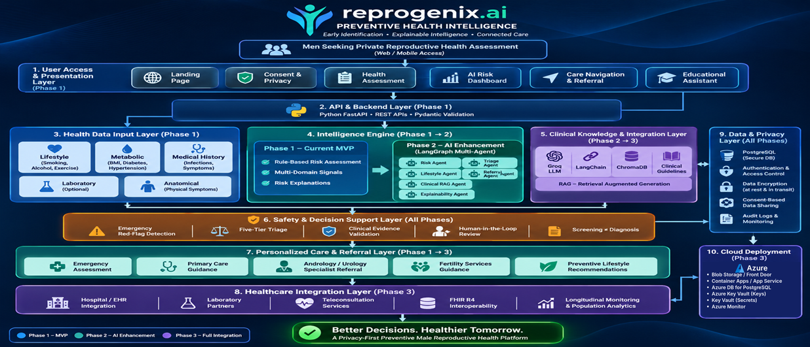
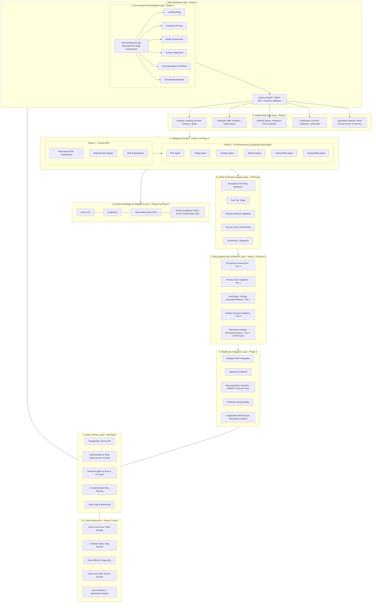

# Reprogenix AI — System Architecture & Clinical Governance

---

## 10-Layer Architecture Breakdown

### 1. User Access & Presentation Layer (Phase 1)
- **Target Audience:** Men seeking confidential, culturally respectful reproductive health assessment on responsive web and mobile browsers.
- **Components:**
  - **Landing Page:** Educational overview of preventive male reproductive health, the biological 72–90 day spermatogenesis cycle, and clinical referral tiers.
  - **Consent & Privacy Gate:** Explicit, unbundled consent mechanism ensuring zero persistent storage without patient authorization.
  - **Health Assessment Intake:** Clean, validated intake capturing lifestyle habits, occupational exposures, medical history, and optional lab values.
  - **AI Risk Dashboard:** Visualized multi-domain risk scores, biomarker radar charts, and personalized modifiability recommendations.
  - **Care Navigation & Referral:** Intelligent guidance matching the patient's risk profile to the appropriate level of care.
  - **Educational Assistant:** Bounded FAQ assistant providing evidence-backed answers cited from WHO, AUA, and EAU guidelines.

### 2. API & Backend Layer (Phase 1)
- **Framework:** Python 3.12+ FastAPI with asynchronous endpoint routing.
- **Contract & Validation:** Strict Pydantic v2 schemas validating numeric bounds, required booleans, and enumeration types.
- **Design Philosophy:** Ephemeral, high-throughput REST APIs designed for zero-PII in-memory execution and sub-50ms latency.

### 3. Health Data Input Layer (Phase 1)
- **Lifestyle:** Nicotine/tobacco usage, alcohol consumption, sleep duration and quality, sedentary behaviors, scrotal heat exposure (laptops, saunas).
- **Metabolic:** Body Mass Index (BMI), type 2 diabetes mellitus, systemic hypertension.
- **Medical History:** Prior genital/urinary tract infections (e.g., epididymitis, STIs), mumps orchitis, pelvic/inguinal surgical history.
- **Anatomical:** Physical scrotal symptoms, clinically diagnosed or suspected varicocele, childhood cryptorchidism (undescended testis).
- **Laboratory (Optional):** Semen volume, sperm concentration, progressive motility (PR), strict normal morphology (WHO 6th Edition, 2021) and endocrine blood panel (Total Testosterone, FSH, LH).

### 4. Intelligence Engine (Phase 1 → Phase 2)
- **Phase 1 — Current MVP:**
  - Deterministic clinical algorithm calculating weighted multi-domain scores.
  - Modifiable risk factor identification with timeline estimates (72–90 days).
  - Clear attribution of risk signals linked to published clinical thresholds.
- **Phase 2 — AI Enhancement (LangGraph Multi-Agent Architecture):**
  - **Risk Agent:** Aggregates multi-domain signals into unified health vectors.
  - **Triage Agent:** Determines referral tier based on clinical urgency and guidelines.
  - **Lifestyle Agent:** Computes individualized lifestyle optimization plans targeting spermatogenesis reversibility.
  - **Referral Agent:** Matches patient geography, cultural preferences, and clinical needs to specialized provider networks.
  - **Clinical RAG Agent:** Retrieves granular evidence from authoritative guideline repositories.
  - **Explainability Agent:** Synthesizes complex clinical rationale into plain, empowering patient language.

### 5. Clinical Knowledge & Integration Layer (Phase 2 → Phase 3)
- **Inference Engine:** Groq LLM accelerator for low-latency, deterministic clinical reasoning.
- **Orchestration:** LangChain for agentic workflows and tool-calling chains.
- **Vector Database:** ChromaDB vector database indexing semantic embeddings of clinical literature.
- **Authoritative Evidence Base:**
  - *World Health Organization (WHO):* Laboratory Manual for the Examination and Processing of Human Semen (6th Ed, 2021).
  - *American Urological Association (AUA) / ASRM:* Diagnosis and Treatment of Infertility in Men (2021/2024).
  - *European Association of Urology (EAU):* Guidelines on Sexual and Reproductive Health (2024).

### 6. Safety & Decision Support Layer (All Phases)
- **Emergency Red-Flag Detection:** Immediate bypass for sudden severe testicular pain (suspected testicular torsion, requiring surgical intervention within 6 hours) — overrides all scoring directly to Tier 0.
- **Five-Tier Safe Clinical Triage:**
  - **Tier 0 (Emergency):** Acute scrotal emergency hospital care.
  - **Tier 1 (Specialist Care):** Andrology and urology specialist evaluation (varicocele, severe oligozoospermia, endocrine disruption).
  - **Tier 2 (Primary Care):** Primary care physician consultation for cardiometabolic, vascular, and medication management.
  - **Tier 3 (Fertility Services):** Couple-centred subfertility investigation (trying to conceive ≥12 months).
  - **Tier 4 (Preventive Self-Care):** Lifestyle optimization and habit reversibility.
- **Clinical Evidence Validation:** Every signal card provides guideline citations and modifiability classifications (Correctable, Modifiable, Permanent).
- **Human-in-the-Loop Review:** Clinician portal enables certified andrologists to audit, calibrate, and verify automated risk outputs.
- **Screening ≠ Diagnosis:** Explicit clinical demarcation ensuring patients understand results indicate risk stratification rather than definitive medical diagnosis.

### 7. Personalized Care & Referral Layer (Phase 1 → Phase 3)
- **Emergency Assessment:** Clear, prominent directions to urgent care or emergency room with triage briefing sheet.
- **Primary Care Guidance:** Actionable summaries for family physicians regarding metabolic syndrome, hypertension, and medication side effects.
- **Specialist Referral:** Direct care navigation to fellowship-trained andrologists and reproductive urologists.
- **Fertility Services:** Couple-synchronous investigation workflows eliminating the historical bias of female-only evaluations.
- **Preventive Lifestyle Recommendations:** Evidence-backed guidance focused on antioxidants (CoQ10, zinc, selenium), temperature regulation (<34.5°C), and sleep architecture.

### 8. Healthcare Integration Layer (Phase 3)
- **Hospital / EHR Integration:** Bi-directional integration with major electronic health record systems via modern APIs.
- **Laboratory Partners:** Integration with CLIA-certified and CAP-accredited diagnostic labs for at-home collection kits and automated results ingestion.
- **Teleconsultation Services:** High-definition encrypted video and audio consultation rooms with interactive speech synthesis and real-time clinical notes.
- **FHIR R4 Interoperability:** Standardized mapping to `QuestionnaireResponse`, `RiskAssessment`, and `Observation` HL7 FHIR resources.
- **Longitudinal Monitoring & Population Analytics:** Cohort tracking over 72-day cycles to evaluate intervention efficacy and public health trends.

### 9. Data & Privacy Layer (All Phases)
- **Secure Database:** PostgreSQL enterprise relational database with row-level security and automated backup snapshots.
- **Authentication & Access Control:** Role-Based Access Control (RBAC) separating public users, registered patients, and verified clinicians.
- **Data Encryption:** Industry-standard AES-256 encryption at rest and TLS 1.3 encryption in transit for all communications.
- **Consent-Based Data Sharing:** Strict patient-controlled permissions for sharing assessment results with attending physicians.
- **Audit Logs & Monitoring:** Immutable audit logs tracking clinical record access, configuration updates, and system operations in accordance with HIPAA Security Rules and GDPR Article 9.

### 10. Cloud Deployment Layer (Phase 3 - Azure)
- **Azure Front Door & Blob Storage:** Global edge content delivery network, SSL termination, and static asset hosting for the React frontend.
- **Azure Container Apps / App Service:** Managed serverless containers running the FastAPI microservices with horizontal auto-scaling.
- **Azure Database for PostgreSQL Flexible Server:** Highly available, zone-redundant database engine with encrypted storage and automated vulnerability assessments.
- **Azure Key Vault:** Centralized hardware security module (HSM) managing cryptographic keys, certificates, and runtime environment secrets.
- **Azure Monitor & Application Insights:** Real-time application performance monitoring (APM), distributed telemetry tracing, and automated alert rules.

---

## Clinical Safety Disclaimers

1. **Non-Diagnostic Scope:** Reprogenix AI is an educational screening and care navigation system. It does not provide formal medical diagnoses or fertility prognosis.
2. **Clinical Confirmation:** All flagged risks, biomarker anomalies, and lifestyle recommendations must be validated by a licensed physician through physical examination, imaging, and laboratory testing.
3. **Emergency Override:** Any acute, sudden, or severe testicular pain must be evaluated at an emergency medical department immediately.
